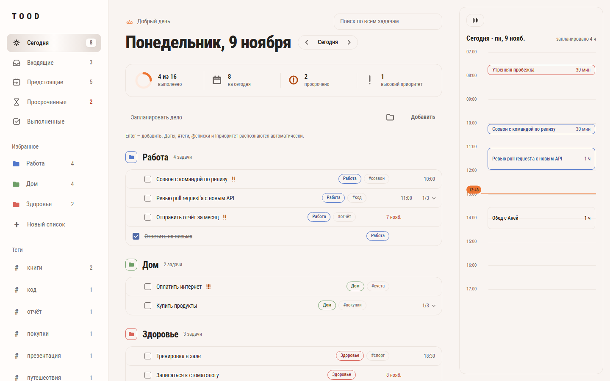
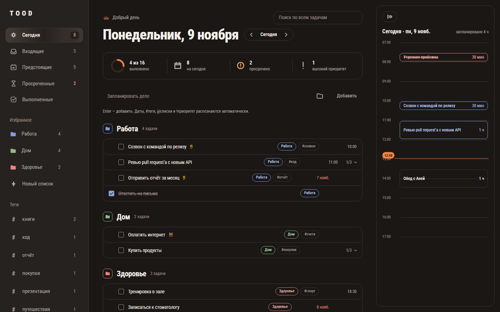
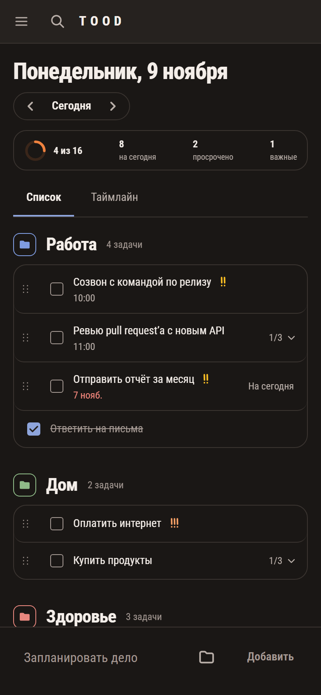
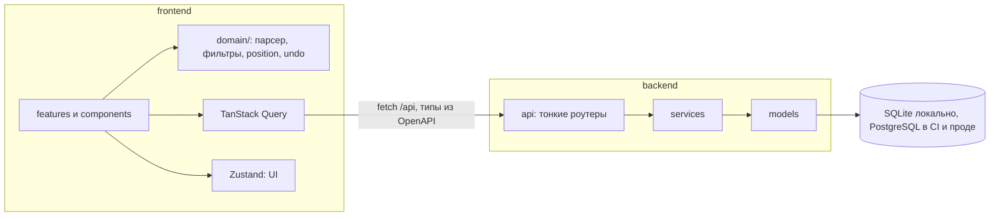

Демо: **https://tood-rfky.onrender.com** — у каждого посетителя свой список с примером недели, регистрации нет. Бесплатный Render засыпает без посетителей: первое открытие может занять до минуты.

# TOOD



<p>
  
  
</p>

Список задач. Данные живут в workspace посетителя и остаются после обновления страницы. Регистрации нет.

Интерфейс — тёплая нейтральная палитра, шрифт Roboto Condensed, одна акцентная обводка. Слово «TOOD» — логотип в сайдбаре.

## Что умеет

- Быстрый ввод: `купить молоко завтра в 18:00 #дом !!` разбирает название, дату, время, тег и приоритет. Грамматика и подсветка токенов — чистая функция [`parseQuickAdd`](frontend/src/domain/quickAdd.ts). Упоминание `@Имя` списка тоже распознаётся там.
- Оптимистичные мутации через TanStack Query: правка видна сразу, ошибка сервера откатывает кеш и показывает тост.
- Undo вместо confirm для задач: тост «Отменить» на 5 секунд (`UNDO_MS`) и Ctrl/Cmd+Z. Удаление — soft delete и `POST /api/tasks/{id}/restore`. Переименование и заметка откатываются клавишей Esc до сохранения. Удаление пользовательского списка — отдельный диалог: у API нет восстановления списка.
- Drag and drop внутри группы ([dnd-kit](frontend/src/features/tasks/SortableTaskGroup.tsx)): мышь, долгое касание и клавиатура (Space/Enter, стрелки, Escape). На узком экране таймлайн дня — вкладка рядом со списком.
- Палитра Ctrl/Cmd+K ([cmdk](frontend/src/features/shortcuts/CommandPalette.tsx)). Остальные хоткеи: `N` новая задача, `/` поиск, `J`/`K` навигация, `X` выполнить, `E` редактировать, Backspace удалить, `?` список клавиш, Ctrl/Cmd+Z отмена.
- Таймлайн дня: задачи со временем на сетке часов, длительность блока из `duration_minutes`, без длительности — 30 минут. Перетаскивание блока меняет время шагом 15 минут.
- Тема `light` / `dark` / `system`, ключ `tood-theme` в localStorage. До первой отрисовки тему ставит скрипт в `frontend/index.html`.
- Анимации Framer Motion (появление строк, layout, чекбокс, смена раздела). `MotionConfig reducedMotion="user"` в [`AppProviders.tsx`](frontend/src/app/AppProviders.tsx): при `prefers-reduced-motion` сдвиги и layout отключены.
- Доступность: семантика, видимый `:focus-visible`, ловушка фокуса в диалогах. Playwright гоняет axe и ждёт пустой `violations` — см. раздел про тесты.
- Новый посетитель в docker compose получает готовые списки «Работа», «Дом», «Здоровье» и задачи на неделю. Состав — [`backend/app/services/demo.py`](backend/app/services/demo.py). Даты считаются от локального дня клиента.

## Запуск

Нужны Docker и Docker Compose.

```bash
docker compose up
```

Фронт: http://localhost:5173. Бэкенд: http://localhost:8000 (`/api/health`, OpenAPI на `/docs`). Vite проксирует `/api` на бэкенд. SQLite лежит в volume `backend-data`. Перед uvicorn выполняется `alembic upgrade head`.

В compose включено `SEED_DEMO_DATA=true`. В настройках приложения флаг по умолчанию выключен, чтобы тесты и пустая установка начинались с пустого списка.

Локальные проверки из `AGENTS.md`:

```bash
cd backend && uv run pytest
cd backend && uv run ruff check . && uv run mypy app
cd frontend && npm run dev
cd frontend && npm run test
cd frontend && npm run e2e
cd frontend && npm run gen:api
```

`npm run gen:api` пересобирает `frontend/openapi.json` и `frontend/src/api/schema.ts` из OpenAPI бэкенда.

## Деплой

Один сервис: [`Dockerfile`](Dockerfile) в корне собирает фронт на Node, затем кладёт `dist` рядом с API в slim-образ Python. FastAPI отдаёт и API, и фронт ([`backend/app/core/spa.py`](backend/app/core/spa.py)): неизвестные пути вне `/api` получают `index.html`, неизвестные `/api/*` остаются JSON 404; хешированные ассеты кешируются на год, `index.html` — `no-cache`; текст сжимается gzip. Перед стартом — `alembic upgrade head`.

Хостинг — Render по [`render.yaml`](render.yaml), база — Neon PostgreSQL. `DATABASE_URL` хранится в секретах Render; провайдерскую строку (`sslmode`, `channel_binding`) под asyncpg приводит `normalize_database_url` в `backend/app/core/config.py`. Включены `SESSION_COOKIE_SECURE` и `SEED_DEMO_DATA`.

## Архитектура

Монорепо: `backend/` и `frontend/`. Контракт один — OpenAPI. Ручных DTO на фронте нет: типы берутся из сгенерированного `frontend/src/api/schema.ts`.

Бэкенд: роутер тонкий (`app/api/`) → сервис (`app/services/`) → модель (`app/models/`). Схема меняется только миграциями Alembic. Каждый запрос фильтруется по `workspace_id` из cookie.

Фронт: логика без React в `src/domain/` — чистые функции, текущее время приходит аргументом `now`, внутри нет `Date.now()`. Серверное состояние — TanStack Query. Zustand — только UI: выделение, панели, тема, тосты.



Анонимная сессия: cookie `todo_workspace`, httpOnly, `SameSite=Lax`, срок год. Workspace создаётся на первом GET/HEAD. Запись без cookie — 401 `session_required`, а не новый workspace: чужой POST без Lax-cookie не должен подменять сессию. Задача или список чужого workspace отвечают 404, как несуществующие.

## Решения и компромиссы

**Теги — JSON-массив строк на задаче**, не таблица many-to-many (`Task.tags`, `MutableList`, иначе in-place правка списка не попадает в UPDATE). Отдельной сущности «тег» нет: нельзя переименовать тег одним запросом, зато нет лишней связи на объёме личного списка. Счётчики тегов считает клиент.

**Умные списки фильтруются на клиенте** (`frontend/src/domain/smartLists.ts`). `GET /api/tasks` отдаёт все неудалённые задачи workspace. «Сегодня» и «просрочено» зависят от локальной даты пользователя, а не от UTC сервера. Данных мало, отдельный query-параметр таймзоны на каждый список не нужен.

**Порядок drag and drop — дробная `position`.** Сдвиг пишет одну задачу: позиция посередине между соседями (`positionBetween` в `frontend/src/domain/position.ts`). Примерно после полусотни делений подряд float перестаёт различать соседей — тогда `moveTo` перенумеровывает список в 1, 2, 3…. `reorderPatches` в этом редком случае записывает и скрытых родителей, сохраняя их взаимный порядок; подзадачи не трогает. Пакетного PATCH нет: при частичном отказе клиент шлёт компенсирующие запросы, затем refetch сверяет кеш с сервером.

**Soft delete ради Undo.** `deleted_at` прячет задачу из выдачи и даёт `restore`. Жёсткое удаление списка обнуляет `list_id` у его задач и не откатывается — поэтому здесь остался диалог подтверждения.

**Workspace без регистрации.** Идентификатор сессии — сам id workspace в httpOnly-cookie. Несколько параллельных первых запросов могут создать несколько workspace: браузер оставит cookie последнего ответа. Клиент сериализует старт сессии (`frontend/src/api/client.ts`).

**Демо и `X-Local-Date`.** Даты примеров относительны к локальному дню посетителя. Клиент шлёт заголовок на каждый запрос. Сервер принимает дату только если она отличается от UTC-дня не больше чем на один день (`MAX_CLIENT_DAY_SKEW`); иначе берёт UTC-день. Так «сегодня» на таймлайне совпадает с календарём человека, а произвольная дата в заголовке не сдвигает демо на месяцы.

## Тесты и качество

Покрытие `src/domain/**` зафиксировано порогом Vitest: 100% statements, branches, functions, lines (`frontend/vite.config.ts`). Команда — `npm run test:coverage`. Остальной фронт измеряется, но порог только у domain.

Бэкенд: pytest + httpx. Модули покрывают health, сессию, модели, схемы, задачи, списки, гонки и демо. Изоляция: `test_foreign_task_is_404_and_untouched`, `test_foreign_list_is_404_and_untouched` — чужой клиент получает 404 и не меняет данные. В CI pytest идёт и против PostgreSQL 17 (`TEST_POSTGRES_URL`); локально и в compose — SQLite.

Playwright (`npm run e2e`): дым, быстрый ввод и повторный показ после reload, список и детали, фазы A–E (поиск, подзадачи, мобильная вёрстка, dnd и хоткеи, Undo и reduced motion). Reload в e2e проверяет повторный GET по фикстурам API в памяти, а не файл SQLite. Что задача переживает рестарт бэкенда, проверяет отдельный шаг CI `docker compose`.

Доступность: [`frontend/e2e/a11y.spec.ts`](frontend/e2e/a11y.spec.ts) — 42 сценария (светлая и тёмная тема, 1440 и 375 px: Сегодня, Входящие, пустой список, детали, палитра, справка, удаление списка, меню, тост; на 375 px ещё drawer, поиск и вкладка таймлайна). Axe с тегами `wcag2a`, `wcag2aa`, `wcag21a`, `wcag21aa`, без выключенных правил. Ожидание — `violations` равен `[]`. Прогон, записанный в приёмке [`tasks/phase-e-polish/handoff.md`](tasks/phase-e-polish/handoff.md): Playwright 100/100, эти 42 проверки без нарушений.

Lighthouse на живом сайте (9 ноября 2026, Lighthouse 12):

| | Performance | Accessibility | Best Practices | SEO |
|---|---|---|---|---|
| Десктоп | 99 | 100 | 100 | 100 |
| Телефон | 97 | 100 | 100 | 100 |

Главный найденный провал был в сдвиге вёрстки (CLS 0.57 на телефоне): задачи рисовались раньше списков и перепрыгивали по группам. Теперь скелетон ждёт оба запроса — CLS 0.04.

CI (`.github/workflows/ci.yml`), push в `main` и `stage-*`, плюс pull request:

| Job | Что делает |
|---|---|
| Backend | `uv sync --frozen`, ruff check, ruff format --check, mypy, pytest |
| Frontend | Node 22.13.0 и 24: eslint, prettier, `tsc -b`, `test:coverage`, production build |
| API contract | `npm run gen:api` и `git diff --exit-code` по `openapi.json` и `schema.ts` |
| E2E | Playwright, Chromium; при падении — артефакт отчёта |
| docker compose smoke | health на :8000 и через прокси :5173, `index.html`, демо у нового посетителя, задача на месте после `docker compose restart backend` |
| Production image on PostgreSQL | сборка корневого `Dockerfile`, запуск на PostgreSQL 16: миграции, SPA, кеш ассетов, API с демо, JSON 404, перезапуск |

## Как велась AI-assisted разработка

Требования лежат в `SPEC.md`, порядок работ — в `PLAN.md`, ограничения для агентов — в `AGENTS.md`. Код писался этапами, а не одним промптом «сделай приложение».

Этапы 0–3 и UX-фазы A–E шли в отдельных ветках. На этап агент получал бриф (`tasks/*/brief.md` для фаз A–E, промпт этапа в `PLAN.md` для ранних стадий) и делал только его. Реализацию делали Claude Code и Codex. Второй проход — ревью диффа против SPEC и AGENTS, без правок в том же проходе; список замечаний чинился отдельно. Что сделано и почему так, а не иначе, записано в `tasks/*/handoff.md`.

Зелёные линтеры и unit-тесты не заменяли браузер. В handoff фаз D и E прямо перечислены баги, которые всплыли только на Playwright и при ручном просмотре: корзина в строке появлялась от фокуса и перехватывала двойной клик, axe ловил несовпадение доступного имени кнопки подзадач и непрокручиваемую область в справке, exit-анимация группы оставляла старые секции в DOM. Это чинилось после прогона, а не «по ощущению модели».

Коммиты — Conventional Commits, маленькие. Зависимости сверх SPEC не добавлялись без причины в сообщении коммита (dnd-kit, cmdk, axe — отдельные chore-коммиты под свою фазу).

## Что дальше

Сознательно не делалось (`SPEC.md`, «Вне скоупа»):

- регистрация и логин;
- совместные списки;
- повторяющиеся задачи;
- уведомления;
- офлайн-синхронизация.
